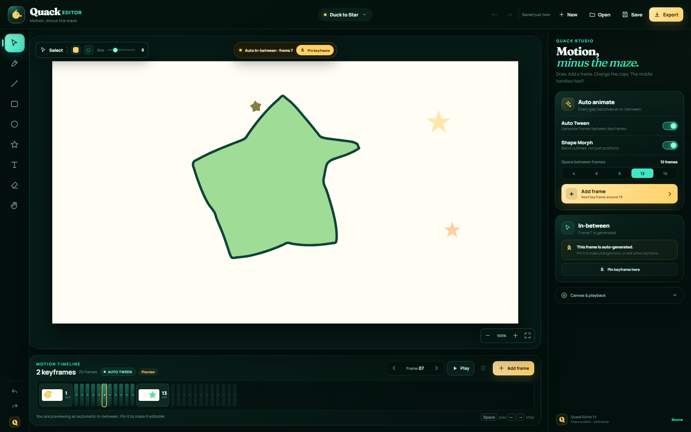
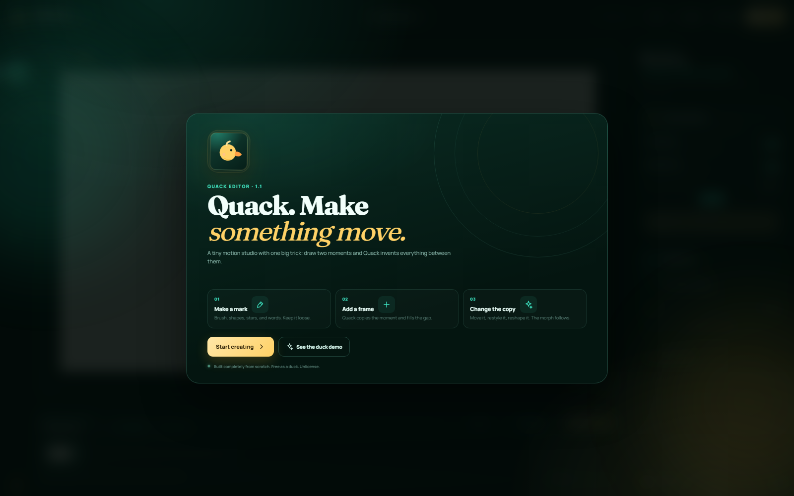
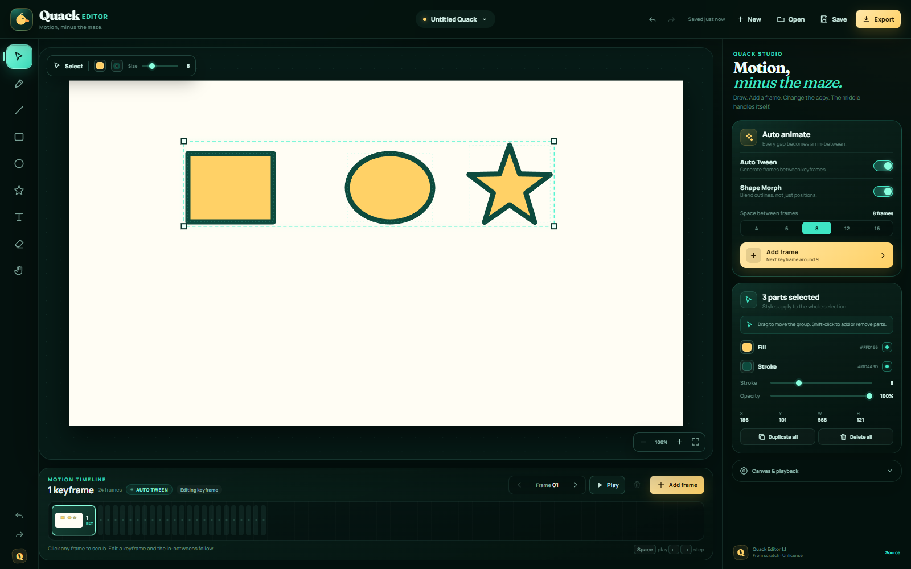

<h1 align="center">Quack Editor</h1>

<p align="center">
  <strong>Draw. Add a frame. Watch the middle invent itself.</strong><br>
  A playful motion studio with automatic tweening and vector shape morphing — written
  completely from scratch, with no Wick Editor or Quick Editor code.
</p>

<p align="center">
  <a href="https://ahpah-dev.github.io/quack-editor/"></a>
  <a href="LICENSE"></a>
</p>



## What it is

Quack Editor is a small, complete animation editor built around one idea: you should
not need a tween graph to make something move.

1. **Make a mark** with the brush, a shape, a star, or text.
2. **Add a frame.** Quack copies the current moment forward.
3. **Change the copy.** Move it, restyle it, or reshape it. Every frame between the two
   keyframes is generated live.

Because the in-betweens are calculated from the two keyframes rather than baked into
the document, editing either end updates the whole transition immediately.



Multi-select with a marquee, or Shift-click parts to add them to the group:



## Features

- **Custom canvas engine** with brush, line, rectangle, ellipse, star, text, eraser,
  select/move, corner resizing, pan, and wheel zoom.
- **Multi-selection**: drag a marquee on empty canvas or Shift-click parts to add/remove
  them. Move and resize the whole group, or batch-style it from the studio panel.
- **Auto-smoothing brush**: a persistent Smooth toggle softens hand jitter while you
  draw and finishes each stroke with a Chaikin smoothing pass.
- **Automatic in-betweening** with a smoothstep time curve.
- **True vector shape morphing**: contours are resampled, winding-aligned, rotated to
  the best seam, and interpolated point by point. Fill, stroke, width, and opacity
  blend along the way.
- **Live keyframe thumbnails** in the timeline.
- **Shape Morph off** gives a motion-only tween; **Auto Tween off** gives hard cuts.
- **Pin keyframe** to make any generated frame editable.
- **Undo and redo** across drawing, moving, resizing, styling, frames, and demo loads.
- **Autosave** to local storage and a debounced “Saved just now” indicator.
- **Readable project files** in JSON with the `.quack` extension.
- **PNG still export** at 2× project resolution.
- **WebM motion export** using the browser’s native MediaRecorder.
- **Responsive studio**: the controls become a slide-over drawer on narrow screens.
- **Keyboard-first**: tool letters, Space to play, arrows to step/nudge, and standard
  undo/redo/save/duplicate shortcuts.

## The duck demo

Open [examples/duck-to-star.quack](examples/duck-to-star.quack) or press **See the duck
demo** on the welcome screen. It contains a hand-built duck silhouette that morphs into
a mint star while the eye and sparkles cross-fade.

## Run locally

Requires **Node.js 20.19+**. Node 22 and Node 26 are tested.

```bash
git clone https://github.com/ahpah-dev/quack-editor.git
cd quack-editor
npm install
npm run dev
```

Open the URL Vite prints (default `http://127.0.0.1:5179`).

### Production build

```bash
npm run build
npm run preview
```

### GitHub Pages build

```bash
npm run build:pages
```

The Pages workflow in `.github/workflows/deploy.yml` builds and deploys automatically
from `master`.

## Keyboard shortcuts

| Key | Action |
| --- | --- |
| `V` / `B` / `L` / `R` / `O` / `S` / `T` / `E` / `H` | Select, Brush, Line, Rectangle, Ellipse, Star, Text, Eraser, Pan |
| Drag empty canvas | Marquee-select parts |
| `Shift` + click | Add or remove a part from the selection |
| `Ctrl/Cmd + A` | Select every part on the current keyframe |
| `Space` | Play / pause |
| `←` / `→` | Step frames when nothing is selected; nudge selection when it is |
| `Shift` + arrows | Nudge by 10 px |
| `Delete` / `Backspace` | Delete selection |
| `Ctrl/Cmd + Z` | Undo |
| `Ctrl/Cmd + Shift + Z` or `Ctrl/Cmd + Y` | Redo |
| `Ctrl/Cmd + D` | Duplicate selection |
| `Ctrl/Cmd + S` | Save `.quack` project |
| `Esc` | Deselect, stop playback, close the mobile studio drawer |

## How the morph works

The editor stores each frame as a list of vector objects with stable IDs. When a frame
sits between two keyframes, Quack:

1. matches objects by ID, then by nearest compatible object for leftovers;
2. resamples both outlines to the same number of points (112 for closed shapes, 80 for
   open paths);
3. reverses winding if needed and rotates the destination contour to the closest seam;
4. interpolates every point, plus fill, stroke, width, and opacity;
5. fades in objects that only exist at the destination and fades out objects that only
   exist at the source.

Text and structurally incompatible paths fall back to a graceful cross-fade rather than
being distorted. Compound silhouettes are stored as separate vector objects, which keeps
the morph predictable.

## Project structure

```
src/
  model/
    geometry.ts   contour sampling and alignment, shape makers, hit testing
    animation.ts  keyframe matching and scene interpolation
    render.ts     canvas renderer and thumbnails
    project.ts    project schema, demo scene, import/export validation
    colors.ts     color parsing and interpolation
  components/     canvas, timeline, studio panel, dialogs, icons, toasts
  hooks/          undo history
  utils/          downloads and file reading
  App.tsx         editor state and orchestration
  styles.css      the entire design system
```

No Wick code, Wick Engine, Paper.js, animation library, or UI kit is used. React is the
view layer; the canvas, geometry, morphing, history, renders, and editor behavior are
original implementations in this repository.

## License

**Everything in this repository is released into the public domain under the
[Unlicense](LICENSE).** You can copy it, remix it, sell it, or ship it without asking.

Third-party runtime dependencies (React, Vite, and the Manrope/Fraunces fonts) keep
their own licenses; the fonts are distributed under the SIL Open Font License.

## Name

Quack Editor is an independent clean-room project. It is not affiliated with Wick
Editor, Wicklets LLC, or Quick Editor. The similarity is limited to the friendly
“draw → add frame → morph” interaction idea, which this project reimplements from
scratch.
